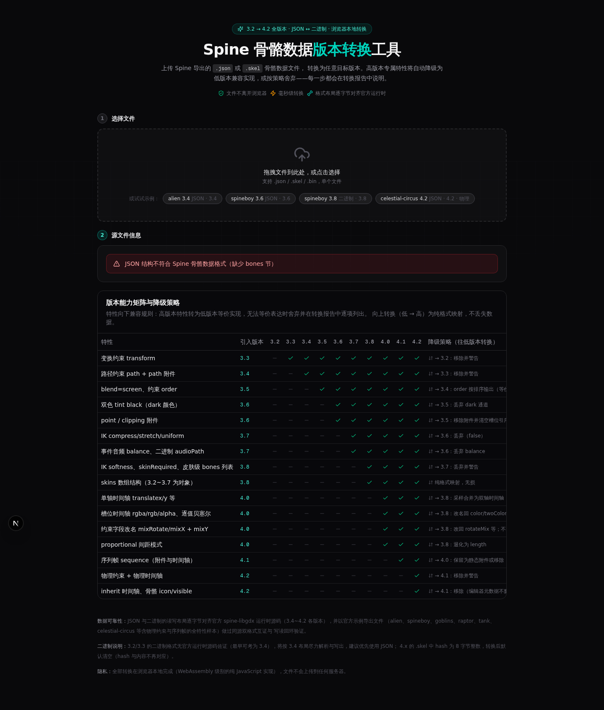

# Spine 版本转换工具

[](https://github.com/firekula/spine-convert/actions/workflows/ci.yml)
[](LICENSE)

**Spine 骨骼动画数据文件转换器 —— JSON ↔ 二进制（.skel）互转，3.2 ~ 4.2 全版本互通。**

全部转换在浏览器本地完成，文件不上传服务器，毫秒级出结果。



## 为什么需要这个工具

Spine 官方编辑器从 4.0 起**不再兼容导入邻近版本的数据文件**——必须使用主次版本完全一致的导出文件才能导入。这意味着手里拿着 3.6 工程导出的 JSON，想在 4.2 编辑器里打开，官方没有提供任何跨版本通路；运行时侧各版本格式差异（字符串引用表、flags 压缩、曲线坐标系、物理约束等）也让手工改造几乎不可行。

本工具基于对官方运行时源码（spine-libgdx 3.5 ~ 4.2 全系 SkeletonJson / SkeletonBinary）逐字节逆向实证，实现完整的**解析 → 版本降级/升级 → 序列化**流水线，任意两个版本之间均可互转，且产出的二进制与官方读取器逐字节兼容。

## 功能特性

- **格式互转**：`.json` ↔ `.skel` 双向转换，任意源格式 + 任意目标格式组合
- **全版本覆盖**：3.2 / 3.3 / 3.4 / 3.5 / 3.6 / 3.7 / 3.8 / 4.0 / 4.1 / 4.2 共 10 个小版本，精确到小版本选择
- **精确版本号写出**：可自定义导出文件内的版本串（如 `4.2.45`），切换目标版本时自动填入该系列默认值；主次版本不一致会被拦截校验，保证 4.0+ 编辑器能导入
- **特性降级引擎**：高版本特性在低版本不存在时，自动转为等价实现或舍弃并逐项报告（详见下方降级策略表）
- **曲线空间自动换算**：4.x 逐值贝塞尔（绝对坐标）与 3.x 共享曲线（归一化坐标）双向无损转换；混合曲线降级时采样合并
- **转换报告**：兼容转换 / 降级 / 舍弃 / 注意 / 说明 五级分类，每一条数据处理决策都有出处
- **版本能力矩阵**：页面内置 16 项特性 × 10 个版本的完整支持表与降级策略说明
- **隐私安全**：纯前端转换，无网络请求，文件不出本机

## 版本支持矩阵

| 版本 | JSON 读取 | JSON 写出 | 二进制读取 | 二进制写出 | 备注 |
|---|:---:|:---:|:---:|:---:|---|
| 3.2 | ✅ | ✅ | ⚠️ | ⚠️ | 二进制无官方源码佐证，按 3.4 家族尽力支持 |
| 3.3 | ✅ | ✅ | ⚠️ | ⚠️ | 同上（3.3 起引入变换约束） |
| 3.4 | ✅ | ✅ | ✅ | ✅ | 路径约束、path 附件 |
| 3.5 | ✅ | ✅ | ✅ | ✅ | 约束 order、骨骼 transform 模式、fps |
| 3.6 | ✅ | ✅ | ✅ | ✅ | 双色槽位、point / clipping 附件 |
| 3.7 | ✅ | ✅ | ✅ | ✅ | IK compress/stretch、事件音频 |
| 3.8 | ✅ | ✅ | ✅ | ✅ | 皮肤 bones/constraints、二进制字符串引用表 |
| 4.0 | ✅ | ✅ | ✅ | ✅ | 逐值曲线、单轴时间轴、rgba 语义 |
| 4.1 | ✅ | ✅ | ✅ | ✅ | sequence 序列帧、deform 改名 attachments |
| 4.2 | ✅ | ✅ | ✅ | ✅ | 物理约束、flags 压缩、referenceScale |

⚠️ = 无官方运行时源码可考（最早可考二进制格式为 3.4），按 3.4 布局尽力解析与写出，建议这两个版本优先使用 JSON。

## 核心降级策略

高版本特性向低版本转换时的处理规则（完整表见工具页面"版本能力矩阵"）：

| 特性（引入版本） | 降级目标 | 策略 |
|---|---|---|
| 变换约束（3.3） | 3.2 | 移除 + 警告 |
| 路径约束 + path 附件（3.4） | ≤3.3 | 移除 + 警告 |
| blend=screen（3.5） | ≤3.4 | 转 normal + 警告 |
| 槽位 dark 颜色（3.6） | ≤3.5 | 丢弃 dark；twoColor 时间轴合并进 color |
| point / clipping 附件（3.6） | ≤3.5 | 移除附件 + 清空槽位引用 + 警告 |
| 单轴时间轴 translatex/y 等（4.0） | ≤3.8 | 采样合并进 translate/scale/shear |
| 槽位 rgba/rgb/rgba2/rgb2/alpha（4.0） | ≤3.8 | 映射回 color/twoColor 并合并 |
| 逐值贝塞尔曲线（4.0） | ≤3.8 | 各值曲线不一致时取第一值曲线 + 警告 |
| 变换约束 mixRotate/mixY（4.0） | ≤3.8 | 改名映射；mixY 不等时丢弃 + 警告 |
| sequence 序列帧（4.1） | ≤4.0 | 按选项：保留为静态附件或移除 |
| 物理约束 + 物理时间轴（4.2） | ≤4.1 | 移除 + 警告 |
| inherit 时间轴（4.2） | ≤4.1 | 移除 + 警告 |
| 骨骼 icon、皮肤 color、referenceScale（4.2） | ≤4.1 | 丢弃（编辑器元数据，不影响运行时） |

反向（低 → 高）升级为无损扩容：缺省字段按官方默认值补齐，曲线坐标系自动换算。

## 快速开始

```bash
# 安装依赖
bun install

# 开发模式（http://localhost:3000）
bun run dev

# 生产构建 + 启动
bun run build
bun run start
```

页面内置 4 个官方示例（alien 3.4 JSON / spineboy 3.6 JSON / spineboy 3.8 二进制 / celestial-circus 4.2 含物理约束），可一键载入体验。

## Docker 部署

镜像发布于 [GitHub Container Registry](https://github.com/firekula/spine-convert/pkgs/container/spine-convert)，支持 `linux/amd64` 与 `linux/arm64` 双架构；每个 [Release](https://github.com/firekula/spine-convert/releases) 另附离线镜像 tar.gz。以下三种方式任选其一。

### 方式一：docker run 直接创建容器

```bash
docker run -d \
  --name spine-convert \
  --restart unless-stopped \
  -p 3000:3000 \
  -v spine-convert-data:/app/data \
  ghcr.io/firekula/spine-convert:latest
```

启动后访问 `http://localhost:3000`。数据持久化在命名卷 `spine-convert-data` 中，升级、重建容器均不会丢失。

常用操作：

```bash
docker logs -f spine-convert                          # 跟踪日志
docker pull ghcr.io/firekula/spine-convert:latest     # 升级：拉取新镜像
docker stop spine-convert && docker rm spine-convert  # 升级：移除旧容器
# 然后重新执行上面的 docker run 即可，数据仍在命名卷中
```

### 方式二：Docker Compose

仓库根目录已提供 [docker-compose.yml](docker-compose.yml)，核心内容如下，可直接复制保存：

```yaml
services:
  spine-convert:
    image: ghcr.io/firekula/spine-convert:latest   # 生产环境建议固定版本，如 :1.2.0
    container_name: spine-convert
    restart: unless-stopped
    ports:
      - "3000:3000"
    volumes:
      - spine-convert-data:/app/data   # SQLite 持久化；绑定宿主机目录见下方说明

volumes:
  spine-convert-data:
```

```bash
# 下载官方 compose 文件（或复制上面内容保存为 docker-compose.yml）
curl -O https://raw.githubusercontent.com/firekula/spine-convert/main/docker-compose.yml

docker compose up -d                            # 启动
docker compose logs -f                          # 跟踪日志
docker compose pull && docker compose up -d     # 升级（数据保留）
docker compose down                             # 停止并移除容器（命名卷保留）
```

改用本地源码构建镜像：把 `image:` 一行换成 `build: .`，执行 `docker compose up -d --build`。

### 方式三：Podman

镜像存于 GHCR（OCI 标准格式），Podman 无需任何适配即可拉取，命令与 docker 基本一致：

```bash
podman run -d \
  --name spine-convert \
  --restart unless-stopped \
  -p 3000:3000 \
  -v spine-convert-data:/app/data \
  ghcr.io/firekula/spine-convert:latest
```

Compose 用户：仓库的 `docker-compose.yml` 原样可用，执行 `podman compose up -d`（Podman ≥ 4.7 内置转发，需已安装 `podman-compose` 或 `docker-compose`）。

Rootless 模式（无 sudo 运行 podman）注意事项：

- 端口 3000 为非特权端口，rootless 可直接绑定，无需额外配置
- 数据持久化推荐**命名卷**（如上例）：空卷首次挂载时按镜像内目录属主（uid 1000）自动初始化，无需手工处理权限
- 改用**绑定宿主机目录**（`-v ./data:/app/data`）时，容器内 uid 1000 映射的是宿主机 subuid 而非宿主 uid，直接 `chown 1000:1000` 无效，需在用户命名空间内调整属主：

  ```bash
  mkdir -p ./data
  podman unshare chown -R 1000:1000 ./data
  ```

  rootful podman 与 docker 行为一致，直接 `sudo chown -R 1000:1000 ./data` 即可
- 开机自启推荐 quadlet（Podman ≥ 4.4）。创建 `~/.config/containers/systemd/spine-convert.container`：

  ```ini
  [Container]
  Image=ghcr.io/firekula/spine-convert:latest
  PublishPort=3000:3000
  Volume=spine-convert-data:/app/data

  [Service]
  Restart=always

  [Install]
  WantedBy=default.target
  ```

  然后启用（rootless 开机自启需先执行 `loginctl enable-linger $USER`）：

  ```bash
  systemctl --user daemon-reload
  systemctl --user start spine-convert
  ```

### 离线导入（从 Release 附件）

```bash
docker load -i spine-convert_1.2.0_docker_amd64.tar.gz   # podman load -i 同样支持
docker run -d -p 3000:3000 -v spine-convert-data:/app/data ghcr.io/firekula/spine-convert:1.2.0
```

### 自行构建

```bash
docker build -t spine-convert .
docker run -d -p 3000:3000 -v spine-convert-data:/app/data spine-convert
```

**说明**

- 容器以非 root（bun 用户，uid 1000）运行；绑定宿主机目录时需先 `mkdir -p ./data && chown -R 1000:1000 ./data`
- 转换全部在浏览器本地完成，容器无对外网络请求，历史记录数据库仅作脚手架预留
- 镜像标签策略：`latest`（main 最新）、`main-<sha>`（指定提交）、`1.2.0` / `1.2`（Release 版本）

## 运行测试

三套回归测试共 **319 项**，全部基于官方示例资产：

```bash
bun run scripts/test-convert.ts          # 216 项：官方同源双格式互证 + round-trip + 跨版本冒烟
bun run scripts/test-att-types.ts        # 52 项：11 类附件 × 5 版本 round-trip
bun run scripts/test-official-compat.ts  # 51 项：官方读取器兼容性（字节级头部校验、贝塞尔计数等）
```

测试依赖 `research/spine/` 下的官方示例导出文件（已随仓库提供）。若该目录缺失，可运行 `scripts/download-branches.sh` 等脚本重新获取（详见"参考资料"一节）。

## 项目结构

```
src/lib/spine/            核心转换库（纯 TypeScript，零依赖，可脱离 UI 使用）
├── types.ts              IR 中间表示（全版本特性超集）
├── spec.ts               版本能力档案（10 版本 × 40+ 特性开关，依据官方源码实证）
├── detect.ts             格式与版本探测（magic number / spine 字段 / 结构推断）
├── jsonReader.ts         JSON 容忍式解析（全版本 → IR）
├── jsonWriter.ts         JSON 版本化序列化（IR → 全版本）
├── binReader.ts          二进制解析（六格式族 A/B/B2/C/D/E/F → IR）
├── binWriter.ts          二进制序列化（IR → 六格式族，与官方读取器逐字节兼容）
├── binIo.ts              varint / float / color 等底层编码原语
├── color.ts              颜色解析与贝塞尔曲线坐标系转换
├── degrade.ts            特性降级引擎（带 Reporter 逐项报告）
├── convert.ts            转换编排：探测 → 解析 → 降级 → 序列化
└── index.ts              公共导出

src/app/page.tsx          主界面（四步流程：上传 → 源信息 → 目标选择 → 结果下载）
src/components/spine/     转换报告渲染、版本能力矩阵组件
public/samples/           页面内置官方示例
scripts/                  测试脚本 + 参考资料下载脚本
research/                 格式规范考证文档与官方参考资产（见下节）
```

### 二进制格式族

| 族 | 版本 | 关键差异 |
|---|---|---|
| A | 3.2 ~ 3.4 | 无 fps / 无字符串表；3.4 用 inheritRotation/inheritScale 布尔 |
| B | 3.5 | 引入约束 order、transform 模式、fps |
| B2 | 3.6 ~ 3.7 | 双色槽位、point / clipping、IK compress/stretch、audioPath |
| C | 3.8 | 字符串引用表、骨架 x/y、皮肤 bones/constraints |
| D | 4.0 | hash 为 8 字节 long、逐值曲线 + bezierCount、字节颜色 |
| E | 4.1 | sequence、deform 节类型字节 |
| F | 4.2 | referenceScale、物理约束、IK/transform/path flags 压缩、变长 short、mesh 新布局 |

## 参考资料

格式规范的权威依据与测试资产（`research/` 目录）：

- `research/spine-format-spec.md` —— 本项目的格式规范速查表（版本能力矩阵、JSON 结构差异、二进制格式族），由官方源码考证整理，是 `src/lib/spine/*` 的实现依据
- `research/spine/branch-*` —— spine-runtimes 官方仓库各分支的示例导出文件（json + skel 成对，测试夹具）
- `research/spine/java-*`、`research/spine/npm/`、`research/spine/*.jar` —— 官方运行时源码（spine-libgdx sources jar 解包 + @esotericsoftware/spine-core），开发期对照用；**不入库**，可通过脚本重新获取：

```bash
scripts/download-maven.sh     # Maven Central 拉 spine-libgdx sources jar（3.5~4.2）
scripts/download-branches.sh  # codeload 拉各分支 tarball 并提取示例导出
scripts/download-research.sh  # spine-ts 运行时源码
```

## 已知限制

- 3.2 / 3.3 的二进制格式无官方运行时源码佐证（最早可考为 3.4），按 3.4 布局尽力支持，建议这两个版本使用 JSON
- 官方个别导出文件存在编辑器自身写出不一致的怪癖（个别 IK 约束 mix/bend 默认值、约束曲线省略），工具按官方运行时语义归一化处理
- 降级转换的语义损失无法避免（如物理约束在 4.1 中不存在），但每一条处理都会在转换报告中列出，不会静默丢弃

## 参与贡献

欢迎 issue 与 PR。开发环境搭建、测试硬性要求、提交与 PR 规范、格式逻辑改动的官方源码证据要求，见 [CONTRIBUTING.md](CONTRIBUTING.md)。

## 版权说明

- 本工具代码：[MIT License](LICENSE) © 2026 firekula
- Spine、spine-runtimes 及其示例资产（`research/` 与 `public/samples/` 中的官方导出文件）：版权所有 © Esoteric Software，Spine Editor 许可证条款，仅供格式研究与此工具的测试用途，不在 MIT 授权范围内
